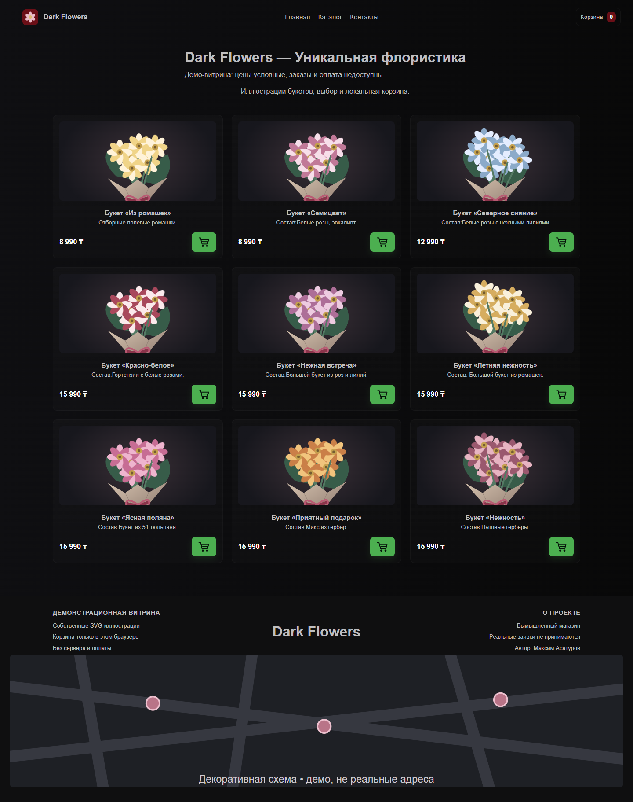
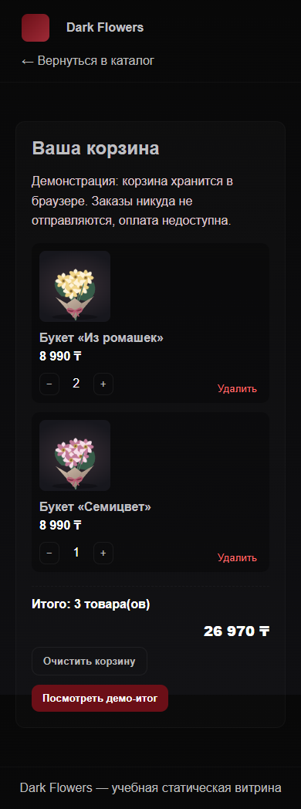

# Dark Flowers

Статическая демонстрационная витрина букетов с корзиной в браузере. Небольшой проект на HTML, CSS и JavaScript: каталог из девяти карточек, переходы между страницами, количество товаров и расчёт суммы без фреймворка.

**Это вымышленный магазин. Цены условные. Сервер, приём заказов, доставка и оплата не реализованы.** Кнопка демо-итога ничего не отправляет и сохраняет корзину.

[Существующее демо на GitHub Pages](https://vortexfront.github.io/dark-flowers/) · [Исходный код](https://github.com/VortexFront/dark-flowers)

Публичная страница может отличаться от локальной версии до утверждения обновления. Проверочные ветки и PR не разворачивают сайт.

## Реальные экраны

Снимки сделаны из работающей локальной версии с собственными SVG-иллюстрациями и синтетической корзиной.




## Что работает

- Девять товаров с разными стабильными ID и одинаковыми названиями в карточке и корзине.
- Добавление товара с переходом в корзину; повторное добавление увеличивает количество той же позиции.
- Счётчик количества, увеличение и уменьшение, удаление, повторное добавление и подтверждаемая очистка.
- Расчёт общей стоимости в тенге; состояние сохраняется в `localStorage` после перезагрузки для того же адреса сайта.
- Рабочие якоря «Главная», «Каталог», «Контакты» и переход обратно из корзины.
- Обычные кнопки доступны с клавиатуры и имеют названия; ошибки сохранения отображаются в интерфейсе.
- Повреждённые данные хранилища не ломают страницу. Старые две позиции с дублировавшимся `p-002` распознаются по прежнему названию ромашек; названия, цены и изображения приводятся к локальному каталогу.

## Стек и устройство

HTML5, CSS3, обычный JavaScript, локальные SVG. В рабочих страницах нет npm-зависимостей, внешних шрифтов, сетевых изображений или карт.

- `index.html`, `index.css`, `index.js` — каталог, оформление и действия карточек.
- `cart-store.js` — общий каталог, проверка сохранённых данных, количество и сумма.
- `cart.html`, `cart.js` — страница локальной корзины и честный демо-итог.
- `assets/` — оригинальные SVG; происхождение описано в [ASSETS.md](ASSETS.md).
- `tests/` — проверки логики, разметки и реальные браузерные сценарии.

## Локальный запуск

Для статического сервера достаточно Node.js 22 или новее:

```sh
npm run serve
```

Откройте `http://127.0.0.1:19370`. Сервер раздаёт только статические файлы на loopback и не содержит API заказов. Другой порт задаётся переменной `PORT`.

Также можно использовать обычный статический хостинг или `python -m http.server 19370 --bind 127.0.0.1`. Открытие через HTTP предпочтительнее `file://`, поскольку поведение хранилища для файлов зависит от браузера.

## Проверки

Для установки только инструментов разработки и проверки:

```sh
npm ci --ignore-scripts
npm run check
npm test
npx playwright install chromium
npm run test:browser
```

`check` проверяет синтаксис JavaScript; это не полноценный lint или TypeScript. Сборщик и отдельная сборка статическому проекту не требуются.

Локально проверены **11 тестов логики/разметки и 10 браузерных сценариев на 390 и 1440 px**: различие первых двух товаров, количество и сумма, перезагрузка, удаление и повторное добавление, очистка, якоря, клавиатура, доступность изображений, старое/повреждённое хранилище, отказ записи и отсутствие ложного оформления. В этих сценариях не было внешних запросов, ошибок страницы, ошибок консоли или горизонтального переполнения. Два скриншота просмотрены визуально.

Ручной smoke-test в обычном интерактивном браузере отдельно не подтверждён; автоматические проверки его не подменяют. CI проверяет статические исходники и браузерные сценарии, сохраняя диагностические артефакты. Workflow не содержит публикации GitHub Pages.

## Ограничения

- Корзина существует только в хранилище браузера для текущего origin; она не синхронизируется с сервером, аккаунтом или другим устройством. Очистка данных сайта удаляет её.
- Количество ограничено 99 единицами одной позиции. Неизвестные товары и некорректные значения в сохранённой корзине игнорируются.
- Нет наличия, скидок, личного кабинета, формы контактов, сервера заказов, платежей или подтверждения доставки. Реальные персональные данные вводить некуда и не требуется.
- Иллюстрации условные и не являются фотографиями реального ассортимента. Декоративная схема внизу не показывает настоящие адреса.
- Покрытие тестами относится к перечисленным сценариям; нагрузочные проверки и полноценный аудит доступности не проводились.

## Автор и вклад

**Максим Асатуров — автор и разработчик проекта целиком:** структура страниц, оформление, каталог, браузерная корзина, проверки и развитие проекта. В работе использовались AI-assisted инструменты для подготовки и проверки кода и SVG. Это описание не утверждает, что каждая строка написана вручную без инструментов. Сторонний инструмент Playwright сохраняет свою лицензию.
